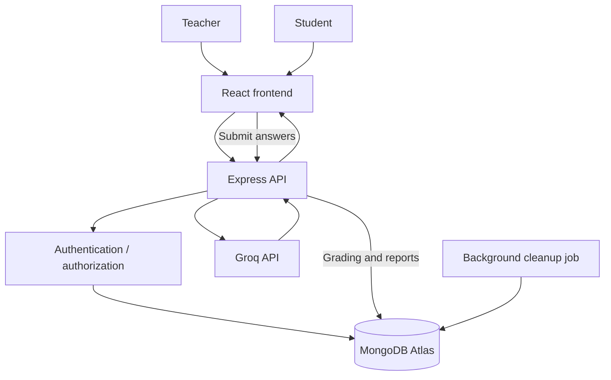

# AI-Powered Quiz Assessment Platform

A full-stack **MERN** application for educators to create, schedule, and manage online assessments. Students can take timed quizzes, while teachers can review results and reports. An optional Groq-powered feature generates questions from a PDF or a topic.

**Live demo:** [Open the Quiz Assessment Platform](https://quizproject-jpc9ids86-personal-1c1e.vercel.app/register)  
**Source code:** [GitHub repository](https://github.com/gitneeraj123/quizproject)

## Features

### AI-assisted question generation
- Generate up to 50 questions (Easy, Medium or Hard) from a PDF or a topic using the Groq API (free tier works).
- Always review AI-generated answers before publishing.
- AI questions are multiple choice; true/false and fill-in-the-blank questions can be added manually.

### Assessment integrity
- Clipboard and context-menu restrictions during assessments.
- Browser-tab/window focus tracking with warnings and violation reporting.
- JWT-based authentication and server-side grading.

> Browser-side restrictions can discourage casual copying but cannot guarantee prevention of cheating on every device or browser.

### Timers and scheduling
- Assessment-wide countdown timers or per-question time limits.
- Scheduled start times for assessments.
- Expiry deadlines and automatic closure of expired quizzes.
- Background cleanup that closes expired quizzes while preserving historical student reports.

### Teacher and student experience
- Create and manage quizzes.
- Navigate large assessments with a question navigator designed to support 100+ questions.
- Responsive interface built with React and Tailwind CSS.
- Custom organization branding support.

## Technology stack

| Area | Technologies |
|---|---|
| Frontend | React, Vite, Tailwind CSS, React Router |
| Backend | Node.js, Express.js |
| Database | MongoDB Atlas, Mongoose |
| AI integration | Groq SDK, `openai/gpt-oss-120b` (override with `GROQ_MODEL`) |
| Security | JWT authentication, Helmet, Express Rate Limit |
| Background tasks | Scheduled cleanup / cron service |

## Application flow



## Local development

### Prerequisites

- Node.js v18 or later
- MongoDB Atlas cluster (or compatible MongoDB instance)
- Groq API key for AI question generation

### 1. Clone the repository

```bash
git clone https://github.com/gitneeraj123/quizproject.git
cd quizproject
```

### 2. Configure and run the backend

```bash
cd server
npm install
```

Create `server/.env` with values required by the application:

```env
PORT=5000
MONGO_URI=your_mongodb_connection_string
JWT_ACCESS_SECRET=replace_with_a_strong_secret
JWT_REFRESH_SECRET=replace_with_a_different_strong_secret
GROQ_API_KEY=your_groq_api_key
CLOUDINARY_CLOUD_NAME=your_cloud_name
CLOUDINARY_API_KEY=your_cloudinary_api_key
CLOUDINARY_API_SECRET=your_cloudinary_api_secret
CLIENT_URL=http://localhost:5173
NODE_ENV=development
```

Start the backend:

```bash
npm run dev
```

### 3. Configure and run the frontend

Open a second terminal:

```bash
cd client
npm install
npm run dev
```

The Vite development server runs at `http://localhost:5173`. Keep backend and frontend environment values aligned with your local setup.

## Environment and security

- Use your own MongoDB connection string and API keys; never commit secrets.
- Use strong, unique JWT secrets and keep production secrets in deployment environment configuration.
- Configure the production client URL and allowed origins before deployment.
- Treat tab monitoring and clipboard restrictions as deterrents, not as a complete anti-cheating guarantee.

## Live demo

[Launch the application](https://quizproject-jpc9ids86-personal-1c1e.vercel.app/register)

If the demo asks you to register, use a test account and avoid entering real or sensitive information.
